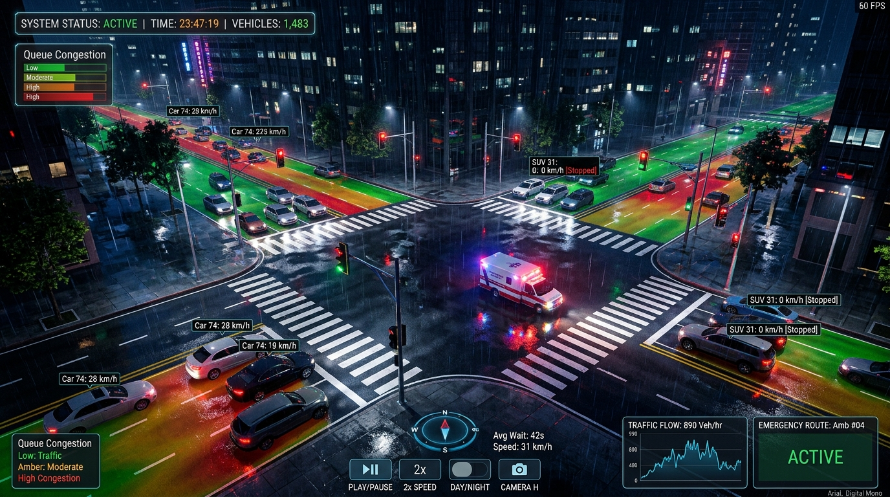
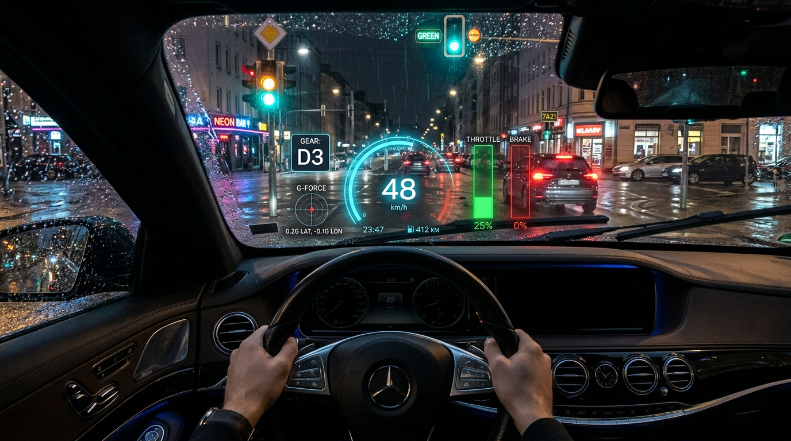

# junction-sim

A discrete-event traffic simulation, microscopic kinematics engine, and signal benchmarking platform for signalized intersections.

[](https://www.python.org/)
[](https://opensource.org/licenses/MIT)
[]()
[]()
[](https://pypi.org/project/junction-sim/)
[](https://bor-code.github.io/Junction-Sim/)

---



## Overview

`junction-sim` is a high-performance discrete-event traffic simulation and signal benchmarking framework built with Python 3.12+ and Pydantic v2. Designed for transportation researchers, traffic engineers, and machine learning practitioners, it combines rigorous queuing theory, microscopic vehicle kinematics (IDM), power-based fuel consumption & CO2 emissions modeling, and photorealistic 3D WebGL visualization with 100% test and branch coverage.

---

## Key Features

- **Microscopic Traffic & IDM Car-Following**:
  - Continuous trajectory generation using the **Intelligent Driver Model (IDM)** with acceleration, deceleration, and headway constraints.
  - Behavioral driver personality profiles: `Cautious`, `Normal`, and `Aggressive`.
  - Non-overlapping queue kinematics, realistic braking behavior, and turn signal indicators.
- **VT-Micro Fuel Consumption & CO2 Emissions Model**:
  - Instantaneous power-based fuel consumption rates (mL/s) and stoichiometric combustion CO2 emission rates (g/s).
  - Explicit differentiation between passenger vehicles and heavy transport (buses, semi-trucks).
  - Accumulated fuel consumption (liters) and carbon footprint (kg CO2) reported across benchmark runs.
- **Reinforcement Learning Signal Control**:
  - Built-in Gymnasium-like `JunctionEnv` with observation quantization and custom reward formulations (`queue_penalty`, `delay_penalty`, `throughput`).
  - Trainable `QLearningController` with epsilon-decay and policy serialization (`save`/`load`).
  - Standalone CLI training workflow: `junction-sim train`.
- **Arterial Corridor Coordination (Green Wave)**:
  - Multi-intersection offset optimization: $\theta_i = (d_i / v_{\text{prog}}) \pmod C$.
  - Progression bandwidth calculation ensuring vehicle platoons pass through consecutive green lights unimpeded (`--controller coordinated`).
- **Photorealistic 3D WebGL Visualizer**:
  - Three.js standalone HTML visualizer with post-processing **UnrealBloomPass** and wet asphalt rain reflections.
  - **First-Person Cockpit Telemetry HUD**: Digital speedometer, dynamic throttle/brake gauges, G-Force accelerometer, and gear indicator.
  - **Asphalt Congestion Heatmap**: Real-time traffic density heatmap rendered directly on the road surface.
  - **Emergency Vehicle Preemption**: Ambulance model with animated siren beacons and green-wave signal clearance.
  - **Live Manual Control Panel**: Interactive traffic signal override to inspect phase switching in real-time.

---



---

## 3D Visualizer Interactive Controls

When viewing the 3D visualizer in your browser (`visualizer.html`), use the keyboard shortcuts or on-screen controls:

| Key | Action | Description |
| :--- | :--- | :--- |
| `C` | **Cinematic Camera** | Sweeping, orbiting aerial view of the junction |
| `O` | **Orbit Camera** | Free orbital camera controls (left-click rotate, right-click pan, scroll zoom) |
| `F` | **Follow Camera** | Third-person dynamic pursuit camera following lead vehicles |
| `D` | **Cockpit HUD** | First-person driver cockpit with digital speedometer and telemetry gauges |
| `H` | **Heatmap Overlay** | Toggles dynamic asphalt queue density heatmap (Green -> Amber -> Red) |
| `M` | **Manual Control** | Toggles the interactive signal override panel (force phase switches) |
| `E` | **Emergency Preempt** | Dispatches an emergency ambulance with strobe beacons and green priority |
| `Space` | **Play / Pause** | Toggles simulation playback |
| `1` / `2` / `3` / `4` | **Playback Speed** | Sets playback speed to 0.5x, 1x, 2x, or 4x |

---

## Benchmark Comparison: Controller Performance

Results from a 120-second comparative benchmark on the `arterial_corridor` preset under identical traffic demands:

| Controller | Served (veh) | Completion % | Avg Delay (s) | Max Queue (veh) | Wasted Green (s) | Fuel Consumed (L) | CO2 Emitted (kg) |
| :--- | :---: | :---: | :---: | :---: | :---: | :---: | :---: |
| **fixed-time** | 66 | 85.71% | 5.970 | 13 | 51.0 | 1.6147 L | 3.8625 kg |
| **actuated** | 71 | 92.21% | 3.352 | 8 | 32.0 | 1.6096 L | 3.8502 kg |
| **max-pressure** | 68 | 88.31% | 3.353 | 9 | 32.0 | 1.5695 L | 3.7542 kg |
| **coordinated** | 66 | 85.71% | 5.955 | 15 | 50.0 | 1.6144 L | 3.8616 kg |

*Note: Actuated and Max-Pressure controllers achieved a ~44% delay reduction and cut wasted green time by 37% relative to uncoordinated fixed-time control.*

---

## Installation

### Using uv (Recommended)

```bash
uv sync --all-extras
```

### From Source

```bash
git clone https://github.com/Bor-Code/Junction-Sim.git
cd Junction-Sim
pip install -e ".[dev]"
```

---

## Command Line Interface (CLI)

### 1. 3D WebGL Visualizer

Export and launch the photorealistic 3D visualizer in your browser:

```bash
junction-sim visualize --preset webster_four_way --controller actuated --duration 60.0 --out-html visualizer.html --open
```

Or run an arterial corridor with green-wave progression:

```bash
junction-sim visualize --preset arterial_corridor --controller coordinated --duration 60.0 --out-html corridor.html --open
```

### 2. Train a Reinforcement Learning Controller

Train a Q-learning agent directly in the simulation environment:

```bash
junction-sim train --preset webster_four_way --episodes 50 --reward-type queue_penalty --out-model trained_agent.json
```

### 3. Run a Simulation

Execute a single-controller simulation run:

```bash
junction-sim run --preset webster_four_way --controller q-learning --duration 120.0 --out-csv run.csv --out-json run.json
```

### 4. Benchmark Controllers

Compare multiple control strategies under identical Poisson traffic arrivals:

```bash
junction-sim benchmark --preset arterial_corridor --controllers fixed-time,actuated,max-pressure,coordinated --duration 120.0 --out-csv benchmark.csv --out-json benchmark.json
```

### 5. Inspect and Export Presets

```bash
junction-sim presets list
junction-sim presets export --preset webster_four_way --out my_scenario.json
```

---

## Python API Quickstart

### Running an IDM Microscopic Simulation

```python
from junction_sim import (
    FixedTimeController,
    SimulationEngine,
    TrajectoryEngine,
    build_webster_four_way_preset,
)

scenario = build_webster_four_way_preset()
intersection, signal_plan, demands, sim_cfg = scenario.build_scenario()

controller = FixedTimeController(signal_plan=signal_plan)
engine = SimulationEngine(
    intersection=intersection,
    signal_plan=signal_plan,
    demands=demands,
    controller=controller,
    step_size=sim_cfg.step_size,
    seed=sim_cfg.seed,
)

results = engine.run(duration=60.0)

# Generate microscopic 3D continuous vehicle trajectories with IDM
traj_engine = TrajectoryEngine(intersection=intersection, signal_plan=signal_plan)
trajectories = traj_engine.generate_vehicle_states(results=results, step_size=0.1)

print(f"Simulated {len(results)} steps and generated {len(trajectories)} 3D trajectory states.")
```

### Computing Fuel & Emissions

```python
from junction_sim.engine.emissions import compute_benchmark_emissions

emissions = compute_benchmark_emissions(results=results, step_size=1.0)
print(f"Fuel consumed: {emissions.fuel_liters:.3f} L")
print(f"CO2 emitted:   {emissions.co2_kg:.3f} kg")
```

---

## Built-in Scenario Presets

| Preset Name | Description | Key Characteristic |
| :--- | :--- | :--- |
| `webster_four_way` | Classic symmetric 4-way intersection (Webster 1958) | Balanced 400 vph Poisson demand, 2-phase equal green |
| `arterial_corridor` | Arterial corridor with major street and cross-street | North-South 800 vph multi-lane, East-West 150 vph single-lane |
| `peak_hour_surge` | Saturated 4-way intersection under heavy surge demand | 850-900 vph per approach approaching saturation capacity |
| `bottleneck_spillback` | Geometry with restricted storage capacities | 15 vehicles/lane capacity testing spillback & queue blockage |

---

## Quality and Verification

- **Type Safety**: Strictly enforced via `mypy --strict`.
- **Style & Linting**: Verified with `ruff`.
- **Test Coverage**: 100.00% statement and branch coverage enforced via `pytest-cov` (363 tests).

```bash
uv run ruff check .
uv run ruff format --check .
uv run mypy src tests
uv run pytest --cov=junction_sim --cov-branch --cov-fail-under=100
```

---

## License

MIT License. See [LICENSE](LICENSE) for details.
